<div align="center">

<h1>
  <picture>
    <source media="(prefers-color-scheme: dark)" srcset="assets/brand/wordmark-dark.svg">
    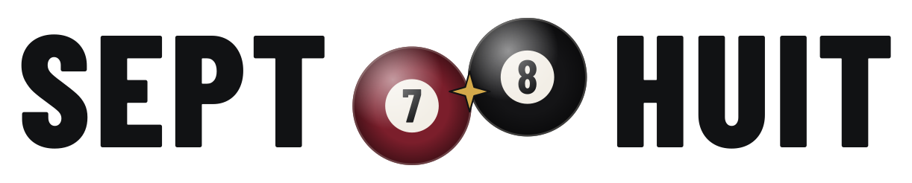
  </picture>
</h1>

**A realism-first 3D pool game presented like a televised tournament.**
Exact event-based physics, a WPA referee, a broadcast director and opponents
guided by a trained neural evaluator. Built from scratch in C++20 and OpenGL 4.1, with no game engine.

[](https://github.com/YoussefSah05/septhuit/actions/workflows/ci.yml)


*Septhuit* is named after **sept & huit** ("seven and eight"), a shot the author grew up with back
home. The logo is the 7 and the 8 kissing.
<!-- TODO(author): one sentence on how the sept & huit shot is played. -->

[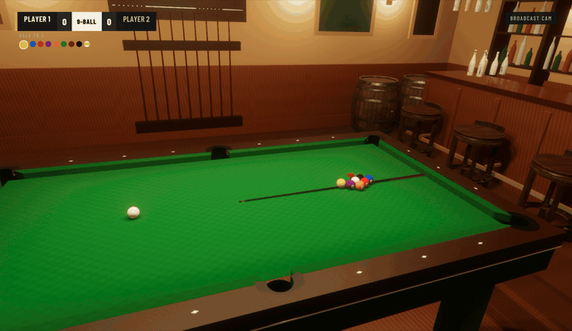](docs/media/demo-break.mp4)

<sub>A full-power 9-ball break, simulated exactly and cut by the broadcast director.
<a href="docs/media/demo-break.mp4">Watch the 120 fps video</a>.</sub>

</div>

---

## Contents

- [Highlights](#highlights)
- [Gallery](#gallery)
- [Quick start](#quick-start)
- [How it works](#how-it-works)
- [Controls](#controls)
- [Developer options](#developer-options)
- [Project layout](#project-layout)
- [Documentation](#documentation)
- [Roadmap](#roadmap)
- [Contributing](#contributing) · [Credits](#credits)

## Highlights

| | |
|---|---|
| 🎱 **Exact physics** | Each shot is solved once, in closed form, when the cue strikes, then played back in real time. Sliding, rolling and spin, ball–ball throw, Han 2005 cushions, pocket jaws and squirt follow the Leckie–Greenspan / pooltool event model. Golden-shot tests check the results against pooltool. |
| 🧑‍⚖️ **A real referee** | WPA 8-, 9- and 10-ball: legal-break checks, ball in hand, push-outs, called shots, spotted balls, the three-foul rule and the referee's choices. Every foul is named on screen. |
| 📺 **Broadcast presentation** | Scorebug, ball trays, lower thirds, shot clock with extensions, a director that cuts to pocket cameras, and slow-motion replays of decisive shots. |
| 🧠 **Trained opponents** | Five named players from club level to champion, plus an **Adaptive** opponent. Candidate-shot search under execution noise is guided by an opponent-conditioned relational Transformer trained by league self-play and exported to ONNX. The Adaptive player estimates your skill from your attempted pots and fouls and adjusts gradually. |
| 💡 **Physically based hall** | GGX shading, cloth sheen, resin balls, cached lamp shadow maps, probe-captured bounce light, bloom and an ACES tone curve. The saloon is furnished with CC0 Poly Haven props. |
| 🔊 **Recorded sound** | 48 recorded samples placed by the simulator. Every contact plays at its exact moment and loudness, with soft, medium and hard layers, cloth roll, jaw knocks and crowd reactions. |
| 🎨 **Your equipment** | The Locker changes cloth, rails, trim, pockets, ball set, cue and hall lighting live on the table behind the menu. |
| 🧪 **Headless core** | Simulation, rules and AI live in a static library with no OpenGL dependency. That library is shared by the doctest suite, the AI arena and a pybind11 module used for reinforcement-learning research. |

## Gallery

<table>
<tr>
<td width="50%">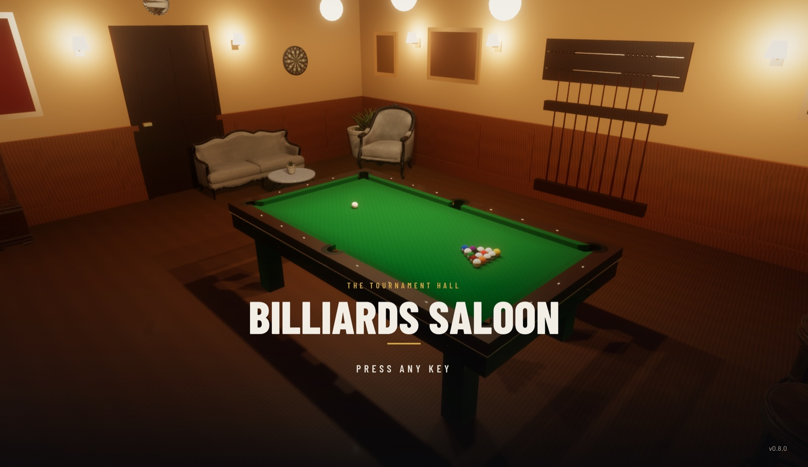<br><sub><b>Title</b>: the menus sit over the live, lit hall.</sub></td>
<td width="50%">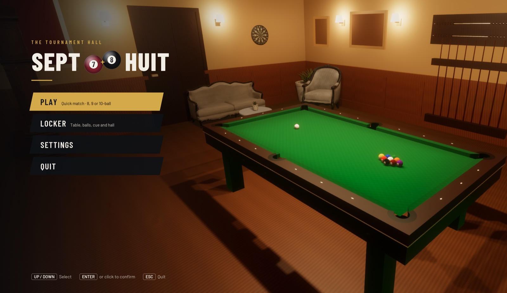<br><sub><b>Main hub</b>: Play, Locker, Settings.</sub></td>
</tr>
<tr>
<td>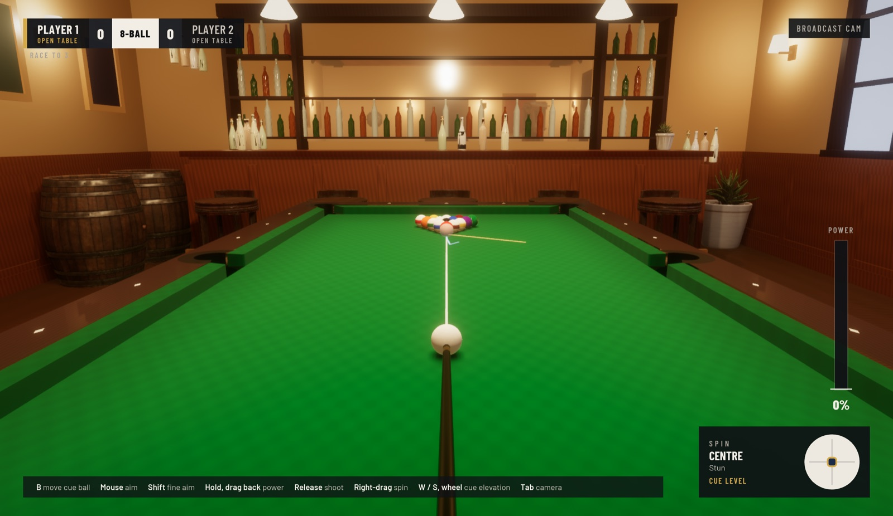<br><sub><b>Aiming</b>: simulator-predicted ghost ball and object/cue lines, power meter and spin widget.</sub></td>
<td>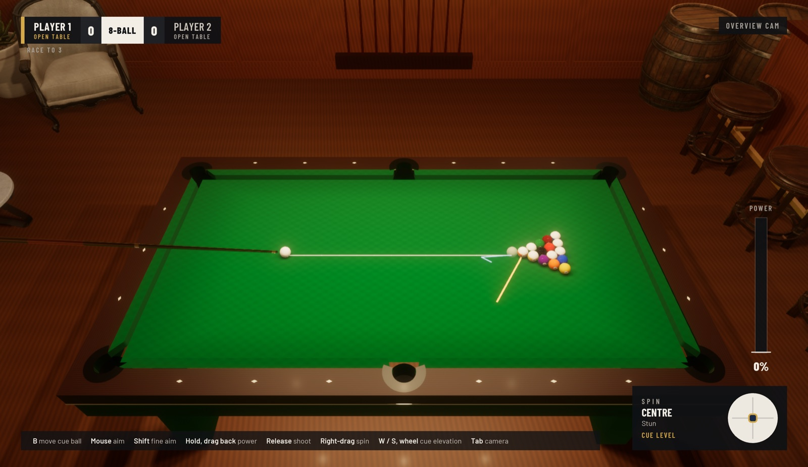<br><sub><b>Overview camera</b>: one of five camera modes.</sub></td>
</tr>
<tr>
<td>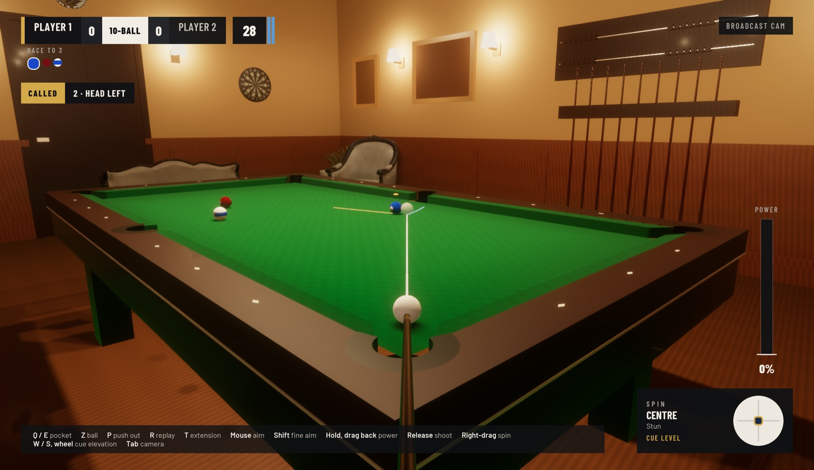<br><sub><b>10-ball</b>: called ball and pocket, 30-second shot clock.</sub></td>
<td>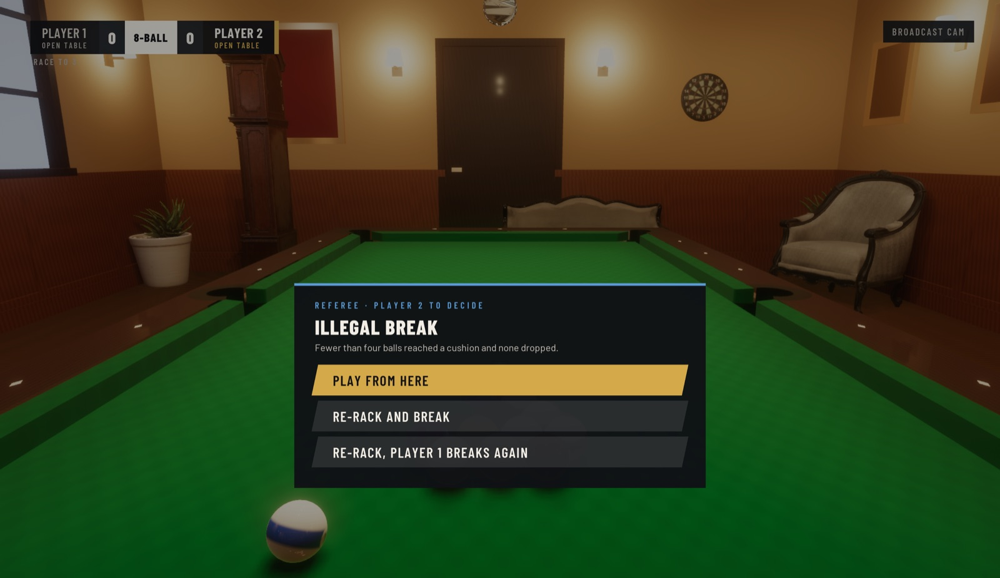<br><sub><b>Referee's choice</b>: an illegal 8-ball break hands the decision to the opponent.</sub></td>
</tr>
<tr>
<td>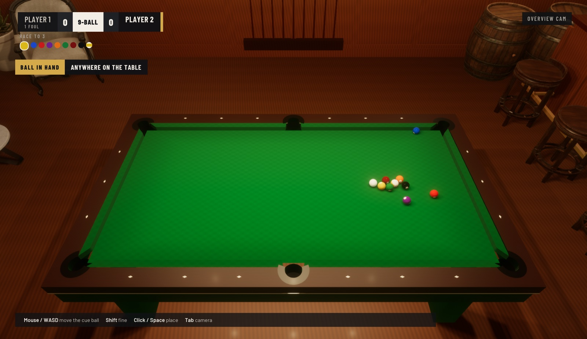<br><sub><b>Ball in hand</b>: the scorebug counts fouls toward the three-foul rule.</sub></td>
<td>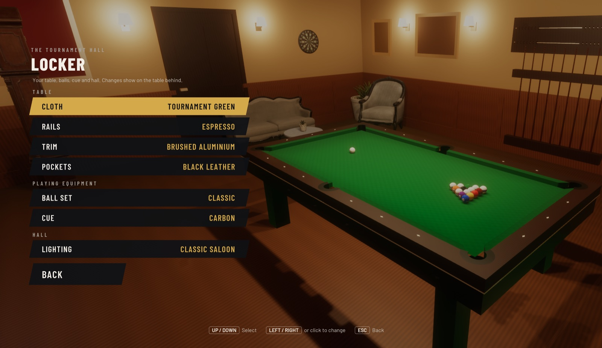<br><sub><b>Locker</b>: equipment changes apply to the table behind the menu.</sub></td>
</tr>
<tr>
<td>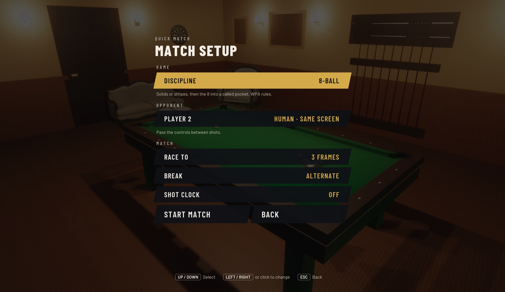<br><sub><b>Match setup</b>: discipline, opponent, race length, break order, shot clock.</sub></td>
<td>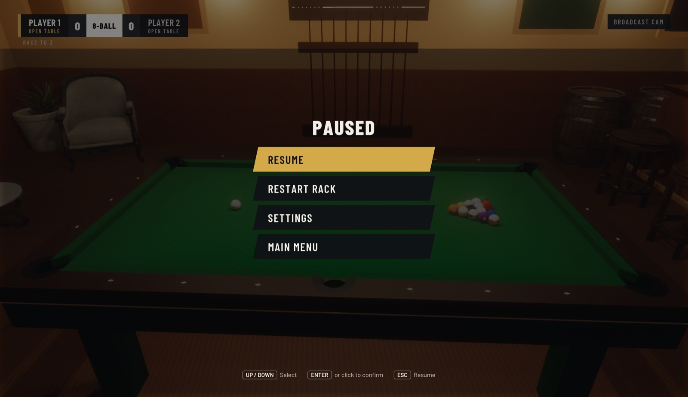<br><sub><b>Pause</b>: over the blurred table.</sub></td>
</tr>
</table>

### Demo: the frame ball and its replay

[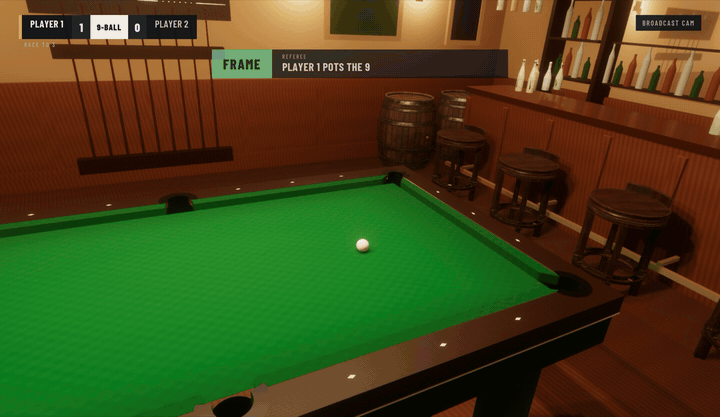](docs/media/demo-replay.mp4)

<sub>The 9 drops to win the frame. The referee calls it, the director replays it in slow motion from the
pocket camera, and the frame-over card follows. <a href="docs/media/demo-replay.mp4">Watch the 120 fps video</a>.</sub>

Every image and clip on this page is captured by the game itself: screenshots with `--capture`, and
clips with `--record` at a fixed 120 Hz game-time step, so they show the real renderer and simulator
frame for frame. The GIFs are 50 fps previews, the most GIFs play reliably in browsers;
the linked MP4s are the full 120 fps. See [Developer options](#developer-options).

## Quick start

Requirements: CMake ≥ 3.28, a C++20 compiler (CI builds with Apple Clang, GCC and MSVC)
and an OpenGL 4.1 driver. GLFW, GLM, RmlUi, FreeType, miniaudio, nlohmann/json and
doctest are fetched automatically; GLAD and stb are bundled in `external/`.

```bash
git clone https://github.com/YoussefSah05/septhuit.git
cd septhuit
cmake -B build -DCMAKE_BUILD_TYPE=Release
cmake --build build -j8
./build/Septhuit                              # assets are copied next to the executable
ctest --test-dir build --output-on-failure    # unit, golden-shot, rules, AI and audio tests
```

- **Release** is the build for playing and measuring. Debug makes simulation-heavy aiming and AI
  planning much slower.
- **Learned AI** fetches the prebuilt ONNX Runtime library (on by default). Use
  `-DBS_WITH_ONNXRUNTIME=OFF` to build with classical evaluation only; the opponents still play.
- **Linux** needs the X11/Wayland development packages listed in [`.github/workflows/ci.yml`](.github/workflows/ci.yml).

| CMake option | Default | Effect |
|---|---|---|
| `BS_WITH_ONNXRUNTIME` | `ON` | Learned AI evaluation with ONNX Runtime |
| `BS_BUILD_TESTS` | `ON` | Build `bs_tests` and `bs_audio_tests` |
| `BS_BUILD_PYTHON` | `OFF` | Build the `billiards_sim` Python module for [`ml/`](ml/README.md) (needs Python 3.12 dev) |
| `BS_WARNINGS_AS_ERRORS` | `OFF` | Treat project warnings as errors (on in macOS CI) |

## How it works

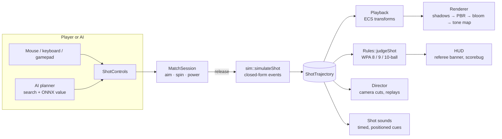

A shot is simulated **completely at strike time**. `ShotTrajectory` holds the ordered events and a
piecewise-analytic motion segment per ball. Playback, slow motion, replays, aim prediction, sound
scheduling and AI evaluation all reuse that one exact result.

<details>
<summary><b>Physics</b>: closed-form motion between events</summary>

A ball sliding on cloth with contact-point velocity $\mathbf{u}$ decelerates under kinetic friction
until the slip vanishes:

$$
t_{\text{slide}} = \frac{2\,\lVert \mathbf{u}_0 \rVert}{7\,\mu_s g},
$$

then rolls with rolling resistance $\mu_r g$. Each ball's position is a polynomial in time between
events. Ball–ball and ball–pocket contact times are roots of quartics, cushion contacts come from
quadratics or quartics, and motion transitions are linear or quadratic. The simulator repeatedly
advances every ball to the earliest event, resolves it, and continues.
Details, parameters and validation: [PHYSICS.md](docs/design/PHYSICS.md).
</details>

<details>
<summary><b>AI</b>: search under noise, scored by a learned value</summary>

The planner generates candidate pots, safeties, kicks and breaks. It simulates each one, has the
referee judge it, and re-runs it with the player's execution error. The resulting positions are scored by a
132,951-parameter relational Transformer over ball tokens and rules/player context. That network
predicts frame-win probability conditioned on both players' execution profiles. It was trained on
mixed-skill league play with Monte Carlo and TD(λ) targets and expert iteration, then exported to
ONNX with parity checks. On held-out positions its log loss is 0.631, against 0.633 for classical
evaluation, and in held-out match play its strength is comparable to classical search. The bundled
model card ([`assets/models/adaptive_ai.json`](assets/models/adaptive_ai.json)) records every
number. If inference fails, the planner falls back to pure physics search.
Theory and results: [INTELLIGENCE.md](docs/design/INTELLIGENCE.md),
[ADAPTIVE_AI.md](docs/design/ADAPTIVE_AI.md), [RELIABLE_AI.md](docs/design/RELIABLE_AI.md),
and the reinforcement-learning research log in [docs/rl/](docs/rl/experiments.md).
</details>

<details>
<summary><b>Rendering</b>: physically based, tuned for a Retina laptop</summary>

The forward HDR renderer uses GGX specular, a cloth sheen lobe, PCF lamp shadows from a shadow-map
array, spherical-harmonic bounce light captured from probes, a bloom chain and ACES filmic tone
mapping. Shadow maps are reused while nothing moves, and Low/Balanced cap the scene at
1280×720 / 1920×1080 while the UI stays native. In the measured scene this took frame time from
15.8 ms to 9.6 ms. Details: [RENDERING.md](docs/design/RENDERING.md), [PERFORMANCE.md](docs/PERFORMANCE.md).
</details>

<details>
<summary><b>Audio</b>: recordings scheduled from simulator events</summary>

`shot_sounds` turns trajectory events into timed, weighted and positioned cues. The miniaudio engine
schedules those cues on the audio clock with preallocated voices and a limited stereo mix, so a
full break never clips. Sources, licences and edit recipes are in [`assets/audio/CREDITS.md`](assets/audio/CREDITS.md).
Details: [AUDIO.md](docs/design/AUDIO.md).
</details>

## Controls

| Action | Mouse | Keyboard | Gamepad |
|--------|-------|----------|---------|
| Aim | Move the mouse (Shift: fine) | A / D (Shift: fine) | Left stick (LB: fine) |
| Shoot | Hold left button, drag back, release | Hold Space, release | Hold A, release |
| Cancel a shot | Push forward again and release | — | — |
| Ball in hand: move / place | Move the mouse, click | WASD or arrows, Space | Left stick, A |
| Move the cue ball again (before shooting) | — | B | RB |
| Called pocket / called ball | — | Q / E pocket, Z ball | D-pad left/right, D-pad up |
| Push out (9- and 10-ball, after the break) | — | P | View |
| Cue elevation (swerve, massé) | Wheel (outside free look) | W / S | RT / LT |
| Spin (cue tip offset) | Hold right button and move | Arrow keys, C to centre | Right stick, X to centre |
| Camera views | — | Tab cycles; 1 aim, 2 overview, 3 follow, 4 free look, 5 broadcast | Y cycles |
| Replay the last shot / skip | — | R / Space | Left stick click / A |
| Shot clock extension | — | T | Right stick click |
| Free look | Right-drag to orbit, wheel to zoom | J/L orbit, I/K tilt, U/O zoom | Right stick orbit, triggers zoom |
| Menus | Point and click | Up/Down, Enter, Esc | D-pad or left stick, A, B |
| Pause | — | Esc | Start |
| Fullscreen | Settings | F11, Alt+Enter, or Cmd+Ctrl+F on macOS | Settings |

On-screen prompts switch between keyboard/mouse and gamepad wording to match the device used last.

## Developer options

```bash
./build/Septhuit --screen game                              # skip the menus (title|main|setup|locker|game|pause|settings)
./build/Septhuit --opponent viktor_hale                     # play an AI player (sam_whitlock … viktor_hale, adaptive)
./build/Septhuit --camera overview                          # broadcast|aim|overview|follow|free
./build/Septhuit --scenario foul|choice|call|replay|break   # script a state: ball in hand, referee choice, called shot, replay, live break
./build/Septhuit --profile --mute                           # frame/GPU time, scene resolution, draw calls once a second
./build/Septhuit --screen pause --capture pause.png         # save one screenshot and quit
./build/Septhuit --scenario break --record frames/ --record-fps 120 --capture-frames 720   # save every frame (BMP) at a fixed game-time step
./build/bs_sound_preview /tmp/sounds                        # export the sound bank and a mixed break as WAV
./build/bs_ai_arena build/assets/models/adaptive_value.onnx 200 dani_reyes nine   # headless learned-vs-classical frames (ONNX builds)
```

<details>
<summary>Regenerating the screenshots and demos</summary>

```bash
for s in title main setup locker settings game pause; do
  ./build/Septhuit --screen $s --capture /tmp/$s.png
done
./build/Septhuit --screen game --camera overview --capture /tmp/overview.png
./build/Septhuit --scenario call --capture /tmp/call.png --capture-frames 200

# A demo clip: record 6 s of game time at 120 fps (raw BMP frames, ~17 MB each
# at Retina size; input is ignored while recording), then encode.
./build/Septhuit --scenario break --record /tmp/rec --record-fps 120 --capture-frames 720
ffmpeg -framerate 120 -i /tmp/rec/frame_%05d.bmp -vf "scale=1280:-2:flags=lanczos" \
  -c:v libx264 -preset slow -crf 20 -pix_fmt yuv420p -movflags +faststart docs/media/demo-break.mp4
ffmpeg -framerate 120 -i /tmp/rec/frame_%05d.bmp \
  -vf "fps=50,scale=720:-1:flags=lanczos,split[a][b];[a]palettegen=stats_mode=diff:max_colors=200[p];[b][p]paletteuse=dither=bayer:bayer_scale=4:diff_mode=rectangle" \
  docs/media/demo-break.gif
```
</details>

## Project layout

| Path | Contents |
|------|----------|
| [`src/sim`](src/sim) | Event-based physics simulator: headless, double precision |
| [`src/rules`](src/rules) | WPA referee as pure functions, shot records, racking, match score |
| [`src/gameplay`](src/gameplay) | Game variants, the match session, broadcast director, equipment catalogue |
| [`src/ai`](src/ai) | Shot planner, player profiles, opponent model, feature encoder, ONNX value model |
| [`src/audio`](src/audio), [`src/app/audio_engine.*`](src/app) | Event-to-cue planning, the recorded bank, miniaudio playback |
| [`src/render`](src/render) | Scene renderer, render targets, shadows, quality presets, cameras, screenshots |
| [`src/app`](src/app), [`src/ui`](src/ui) | Main loop, RmlUi screens (menus, HUD, Locker, setup), the saloon scene |
| [`src/ecs`](src/ecs), [`src/core`](src/core), [`src/platform`](src/platform) | Sparse-set ECS, asset paths, settings, launch options, window/input/timer |
| [`src/python`](src/python) | pybind11 bindings of the simulator, rules and AI (`billiards_sim`) |
| [`assets/`](assets) | Shaders, RmlUi documents and theme, JSON game data, models, audio, fonts |
| [`ml/`](ml/README.md) | PyTorch training: adaptive value model, RL environments, self-play, ONNX export |
| [`tests/`](tests) | doctest suites: physics (golden shots vs pooltool), rules per WPA clause, session, AI, audio, rendering presets |
| [`tools/`](tools) | AI arena, sound preview, audio importer, golden-shot generator |
| [`docs/`](docs/README.md) | Design documents, architecture, performance notes, RL research log |

## Documentation

Start at the **[documentation map](docs/README.md)**. The design documents explain the theory behind
each part (models, equations and the reasons for each choice), not just the code.

| Area | Document |
|---|---|
| Game design | [GDD.md](docs/design/GDD.md) · [UX.md](docs/design/UX.md) · [RULES.md](docs/design/RULES.md) |
| Engine | [ARCHITECTURE.md](docs/ARCHITECTURE.md) · [PHYSICS.md](docs/design/PHYSICS.md) · [RENDERING.md](docs/design/RENDERING.md) · [AUDIO.md](docs/design/AUDIO.md) · [PERFORMANCE.md](docs/PERFORMANCE.md) |
| Intelligence | [AI.md](docs/design/AI.md) · [INTELLIGENCE.md](docs/design/INTELLIGENCE.md) · [ADAPTIVE_AI.md](docs/design/ADAPTIVE_AI.md) · [RELIABLE_AI.md](docs/design/RELIABLE_AI.md) · [RL experiments](docs/rl/experiments.md) |
| Process | [CONTRIBUTING.md](CONTRIBUTING.md) · [CHANGELOG.md](CHANGELOG.md) · [CREDITS.md](CREDITS.md) |
| Brand | Logo, icon and social preview in [`assets/brand/`](assets/brand), generated by [`tools/brand/make_brand.py`](tools/brand/make_brand.py) |

## Roadmap

| Milestone | Status |
|---|---|
| M1–M2 Foundation, RmlUi frontend, settings, gamepad | ✅ v0.2–v0.3 |
| M3–M4 Event-based physics, WPA referee | ✅ v0.4 |
| M5 Shot input and broadcast presentation | ✅ v0.5 |
| M6 Hall visuals and equipment | ✅ v0.6 |
| M7 Audio | ✅ v0.7 (recorded bank in *Unreleased*) |
| M8 Classical AI opponents | ✅ v0.8 |
| M9 Intelligence: learned evaluator, Adaptive opponent, RL research | 🟡 in *Unreleased* |
| M10 Modes: Practice, Trick Shots, The Tour (career) | ⏳ planned |
| M11 Ship: packaging and release | ⏳ planned |

Known gaps: no jump shots yet (they need airborne-ball physics), no saves or career, and no AI coach.
See [GDD.md](docs/design/GDD.md) for v1.0 scope and [CHANGELOG.md](CHANGELOG.md) for what has landed.

## Contributing

Work happens on `feat/`, `fix/`, `docs/`… branches that are merged into `main` with `--no-ff`.
Commits follow Conventional Commits, and every change adds a line to the *Unreleased* changelog.
Builds stay warning-free under `-Wall -Wextra -Wpedantic -Wconversion -Wshadow`. Simulation code stays
free of OpenGL so it can run headless. The full workflow is in [CONTRIBUTING.md](CONTRIBUTING.md).

## Credits

Third-party libraries, fonts and models are listed in [CREDITS.md](CREDITS.md). Sound
recordings and their licences are listed in [assets/audio/CREDITS.md](assets/audio/CREDITS.md). The physics follows
Leckie & Greenspan (2006), Kiefl's [pooltool](https://pooltool.readthedocs.io) (JOSS 2024) and
Han (2005). Rules follow the [WPA Rules of Play](https://wpapool.com).
