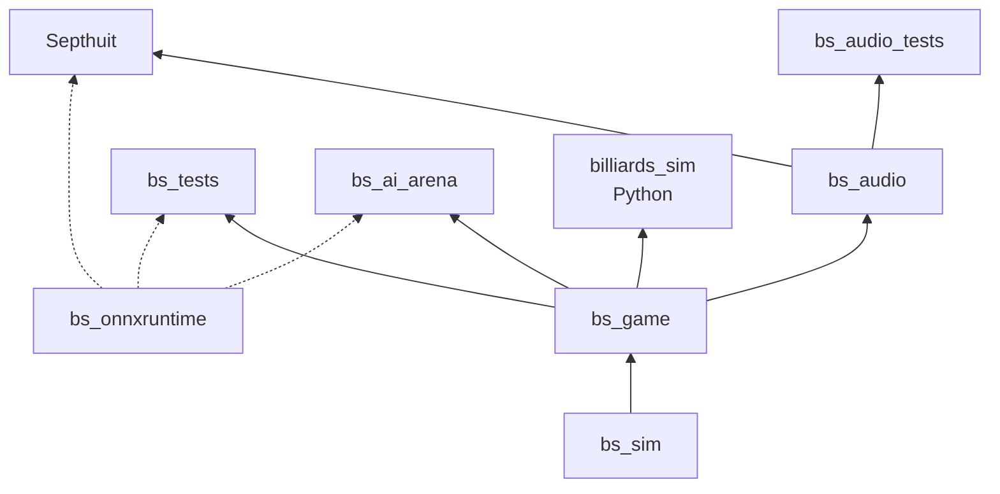

# Architecture

C++20, OpenGL 4.1 core (the macOS ceiling: no compute shaders, no DSA), GLFW,
GLM, no game engine. See `docs/design/GDD.md` for what the game must do.

## Current state

| Target | Kind | Contents |
|--------|------|----------|
| `bs_sim` | static library | The event-based physics simulator. Headless, double precision. |
| `bs_game` | static library | Everything else that runs headless: rules, match session, director, equipment, AI planner, shot-sound planning. No OpenGL/GLFW. |
| `bs_audio` | static library | miniaudio playback and the recorded sample bank, on top of `bs_game`. |
| `Septhuit` | executable | Window, renderer, RmlUi screens, main loop. |
| `bs_tests`, `bs_audio_tests` | executables | doctest suites (`bs_tests` links `bs_game`; with ONNX it also checks the bundled model). |
| `bs_ai_arena`, `bs_sound_preview` | tools | Headless learned-vs-classical frames; WAV export of the sound bank and a mixed break. |
| `billiards_sim` | Python module (optional) | pybind11 bindings of the simulator, rules and AI for `ml/`. |
| `bs_onnxruntime` | imported library (optional) | Prebuilt ONNX Runtime for learned evaluation (`BS_WITH_ONNXRUNTIME`, on by default). |



| Path | Target | Role |
|------|--------|------|
| `src/core/asset_paths.*` | bs_game | `resolveAssetPath`: exe-relative asset lookup (build tree, macOS bundle, source fallback). |
| `src/ecs/` | bs_game | Sparse-set `Registry` with `view<...>().each(...)`. |
| `src/scene/hall_geometry.*` | bs_game | Headless hall layouts (arena, saloon) and their lamp positions. |
| `src/scene/table_geometry.*`, `mesh_data.h` | bs_game | Headless meshes for the table furniture (cushions from the simulator's segments, rails with pocket cut-outs, rims, drops, sights, trim, apron, legs); the renderer uploads `MeshData` on first draw. |
| `src/scene/components.h` | bs_game | Transform (with previous state for interpolation), Ball, Material, TableBounds, Camera tags. |
| `src/gameplay/game_variant.*` | bs_game | Variant/table types, JSON loaders, rack layouts. |
| `src/gameplay/match_session.*` | bs_game | A match: ECS world, shot state machine (place, aim, tip offset, elevation, charge, fire), playback, shot preview, replays, shot clock, referee, ball in hand, spotting, calls, push-outs, race to N. |
| `src/rules/` | bs_game | WPA referee for 8-, 9- and 10-ball as pure functions (`judgeShot`, `applyChoice`), shot records from simulator events, racking, match score. See design/RULES.md. |
| `src/sim/` | bs_sim | Event-based simulator: roots, motion, table geometry, event detection, collision models, `simulateShot` → `ShotTrajectory`. The game's physics. See design/PHYSICS.md. |
| `src/ai/` | bs_game | `planner` (candidate pots, safeties, kicks; simulate, judge, re-run with execution error; placement, break, choices), `ai_profile` (players and skill calibration from `assets/data/ai/`), `features` (the 256 features shared with training), `opponent_model` (Adaptive skill estimate from attempted pots and fouls), `environment` (headless frames for training), `ai_table` (a thread-safe copy of the table). |
| `src/ai/value_model.*` | app, tests, arena | ONNX Runtime inference of the bundled value network (`assets/models/adaptive_value.onnx`); validates names, shapes and outputs, with search fallback. See design/ADAPTIVE_AI.md. |
| `src/audio/` | bs_game, bs_audio | `shot_sounds`: simulator events to timed, weighted, positioned cues. `recorded_bank`: decodes the recorded samples in `assets/audio/` and picks impact layers. |
| `src/app/audio_engine.*` | bs_audio | miniaudio playback: preallocated voices, effects/crowd/interface buses, contacts scheduled on the audio clock, stereo placement from the camera, a limited mix. |
| `src/render/render_quality.h` | app | Low/Balanced/High presets: scene-resolution caps, shadow and post settings. See PERFORMANCE.md. |
| `src/python/` | billiards_sim | pybind11 bindings: simulator, RL shot API, rules, environment, features. |
| `ml/` | — | PyTorch training: the adaptive value model, the reliable-ensemble experiment, RL agents and experiments, ONNX export. See ml/README.md. |
| `src/gameplay/equipment.*` | bs_game | Equipment catalogue (cloth, rails, trim, pockets, ball sets, cues, halls) loaded from `assets/data/equipment/catalog.json`. |
| `src/gameplay/director.*` | bs_game | Broadcast director: plans camera cuts (pocket camera, wide) from a simulated trajectory. |
| `src/gameplay/sim_bridge.h` | bs_game | Game ↔ simulator frame conversion. |
| `src/platform/` | app | `Window` (GLFW, vsync on), `Input` (key edge detection), `Timer`. |
| `src/render/` | app | `SceneRenderer` (cached shadow pass, HDR scene, cue, guides, post chain), `render_targets` (MSAA HDR buffer at the preset's scene resolution, bloom chain, shadow map array), `number_atlas` (ball numbers via FreeType), `Shader`, `Mesh`, `Camera`, `camera_rig`. |
| `src/app/` | app | `Application` (loop, screens, camera rig), `saloon_scene` (room, lamps, ball materials), RmlUi screens: `shell_menus` (title, hub, pause, frame over, confirm, referee choice), `match_setup_screen`, `settings_screen`, `hud_screen`. |
| `assets/data/` | — | Game data: `variants/*.json` (rules discipline, rack, balls) and `tables/*.json` (dimensions, pockets, physics coefficients). |
| `assets/shaders/` | — | `basic.*`: physically based forward shading (GGX, ball resin, cloth sheen, PCF lamp shadows, ball numbers) into an HDR buffer; `shadow.*` depth pass; `bloom_*` and `post.frag`: bloom, ACES filmic tone curve, vignette, sRGB. |
| `tests/` | bs_tests | doctest suites: ECS, simulator (closed-form, golden shots vs pooltool), rules per WPA clause, session, data loading, AI and Adaptive opponent, value model, render presets, audio planning and the offline mixer. |

Known limitations: no jump shots yet (they need airborne-ball physics); no
saves, career or AI coach; the hall's probe capture causes a one-off hitch
after loading or changing hall lighting.

## Target architecture (v1.0)

```
src/
  core/      logging, JSON config (nlohmann), event bus, asset path resolver, app state stack
  platform/  window, input actions & rebinding, gamepad, user-data dir
  sim/       headless, double precision, no GL — the physics library (bs_sim)
  game/      RuleSet (8/9/10-ball WPA), Referee, MatchController, modes, profiles & saves
  ai/        shot generation + evaluation through sim, difficulty profiles
  present/   ShotPlayback, camera director, replay, stats
  render/    passes: shadow → PBR main → transparent → post (HDR, bloom, tonemap)
  ui/        RmlUi menus/HUD bound to view models (assets/ui/*.rml, *.rcss); Dear ImGui for debug tools only
  audio/     miniaudio, driven by sim events
  ecs/       existing Registry
  python/    pybind11 bindings of the simulator and rules (optional build)
ml/          Python training project: env, agents, self-play, ONNX export (see design/INTELLIGENCE.md)
tests/       doctest unit, golden-shot and rules tests
```

### Shot data flow

```
input ──► ShotParams ──► sim::simulateShot(TableState, ShotParams) ──► ShotTrajectory
                                                                         │
            ┌──────────────────┬──────────────────┬──────────────────────┤
            ▼                  ▼                  ▼                      ▼
        Referee           ShotPlayback       event bus → audio,     Replay (params +
     (ShotVerdict →      (evaluate at t →     camera director,      start state =
     MatchController)     ECS transforms)     stats                 deterministic)
```

A shot is simulated completely at strike time. `ShotTrajectory` holds the
ordered events (collisions, cushion hits, pockets, motion transitions) and a
piecewise-analytic segment per ball, so playback, slow motion, replays, aim
prediction and AI evaluation all reuse the same exact result.

### Event-based simulator (`sim/`)

Equations, parameters and validation: [design/PHYSICS.md](design/PHYSICS.md).

Following Leckie & Greenspan (2006) and pooltool (Kiefl, JOSS 2024):

- Ball motion states: stationary, spinning, sliding, rolling, airborne.
- Each step computes every candidate event time (transitions: linear/quadratic;
  ball-ball and ball-pocket: quartic; cushion: quadratic/quartic), advances all
  balls analytically to the earliest event, resolves it, repeats.
- Resolvers: stick-ball (squirt/swerve, elevation), ball-ball (frictional
  inelastic, later Mathavan), cushion (Han 2005, later Mathavan 2010), pocket,
  transitions.
- Table geometry: linear cushion segments, circular jaw corners, pocket
  circles, WPA 9 ft dimensions.

### Milestone order

M0 housekeeping ✅ · M1 foundation ✅ · M2 UX foundation and broadcast
frontend ✅ · M3 event-based physics ✅ · M4 WPA rules and referee ✅ · M5 shot input
and presentation ✅ · M6 hall visuals, realism and customization ✅ · M7 audio ✅ ·
M8 AI v1 (classical search) ✅ · M9 intelligence (learned evaluator and
Adaptive opponent landed; RL research continues, see rl/experiments.md) ·
M10 modes · M11 ship.
UX comes before physics because every later milestone presents itself
through it (referee banners, ball in hand, opponent cards, season hub).

### Git workflow

- `main` is always buildable. One branch per milestone (`feat/sim-core`,
  `feat/rules-wpa`, ...), Conventional Commits, merged via PR with green CI.
- `v0.1.0-prototype` tags the pre-rewrite baseline.
- The old solver stays behind a backend switch until the event simulator passes
  golden-shot tests, then is removed in one dedicated commit.

## References

- Leckie & Greenspan, *An Event-Based Pool Physics Simulator* (ACG 2005, LNCS 4250).
- Kiefl, *Pooltool: A Python package for realistic billiards simulation*, JOSS 2024 —
  https://pooltool.readthedocs.io, https://ekiefl.github.io/2020/12/20/pooltool-alg/
- Han, *Dynamics in Carom and Three Cushion Billiards*, JMST 19(4), 2005.
- Mathavan et al., *A theoretical analysis of billiard ball dynamics under cushion impacts*, 2010.
- Dr. Dave Alciatore, pool physics resources — https://drdavepoolinfo.com/physics/
- WPA Rules of Play (2025-09-15) — https://wpapool.com
